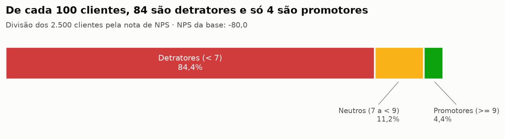

# Previsão de NPS de E-commerce

**Tech Challenge · Fase 1 · AI Scientist (POSTECH/FIAP)**

Projeto unificado de análise de negócio e engenharia de machine learning. A EDA do Projeto A
permanece como a leitura de negócio principal, agora junto do pipeline modular e do semáforo de
risco do Projeto B.



## Contexto e diagnóstico

O NPS só é conhecido depois que a jornada de compra termina. Nesse momento, a operação descobre a
insatisfação tarde demais para corrigir a experiência. A análise da base aponta a logística como
um sinal prioritário: o tempo total de entrega, por si só, não resume a experiência; o atraso em
relação à promessa é que acompanha a queda mais acentuada das notas. Atrasos, reclamações, contatos
com o atendimento e tempo de resolução também apresentam associações negativas com o NPS.

Essa leitura é observacional, não causal. Os resultados servem para priorizar investigação e ações
piloto, não para afirmar que uma intervenção específica causará aumento de NPS. A base ainda contém
anomalias que precisam ser confirmadas com a fonte, incluindo `repeat_purchase_30d`, que coincide
perfeitamente com `nps_score >= 8` e não é uma medida independente de retenção.

## Resultados principais

- **NPS da base: −80 pontos**: 2.109 detratores (84,4%), 281 neutros (11,2%) e 110 promotores
  (4,4%), pela régua oficial definida abaixo.
- **Sinais operacionais prioritários:** atraso na entrega e reclamações têm as maiores associações
  negativas observadas com a nota. O perfil do cliente ou do pedido não deve ser tratado como causa
  sem validação adicional.
- **Modelo selecionado:** regressão linear, escolhida entre os modelos comparados por validação
  cruzada. No conjunto de teste, obteve MAE de **1,386 ponto**, contra **2,105** do baseline da
  média, e ROC-AUC de **0,868** na ordenação de detratores pela nota prevista.
- **Semáforo de risco:** na faixa **Crítico**, 100% dos pedidos do teste eram de detratores reais.
  A saída de inferência também aponta o principal fator operacional e uma ação recomendada por
  pedido.
- **Impacto estimado:** o modelo associou cada dia adicional de atraso a aproximadamente **−0,955**
  ponto previsto. É uma associação do modelo, não uma estimativa causal.

As métricas e os resultados detalhados estão em [`models/metrics.json`](models/metrics.json) e
[`reports/02_resumo_executivo.md`](reports/02_resumo_executivo.md).

## Régua de NPS

Como `nps_score` é contínua e contém casas decimais, não arredondamos a nota:

| Categoria | Regra |
|---|---|
| Detrator | `nps_score < 7` |
| Neutro | `7 <= nps_score < 9` |
| Promotor | `nps_score >= 9` |

A mesma convenção é usada no notebook, nos scripts, nos gráficos e na avaliação do modelo.

## Prevenção de data leakage

`csat_internal_score` é outra medida de satisfação, e `repeat_purchase_30d` só é conhecida depois
da experiência. Portanto, nenhuma das duas pode ser usada para prever NPS antes da pesquisa. O
helper `drop_leakage_columns` em [`src/data_prep.py`](src/data_prep.py) retira ambas do conjunto de
modelagem; [`src/train_model.py`](src/train_model.py) chama essa proteção antes da divisão treino /
teste e da regressão. A seleção positiva de `MODEL_FEATURES` em `src/config.py` mantém ainda uma
segunda barreira contra a entrada acidental de outras colunas.

Os campos permanecem na base bruta e tratada para auditoria e análise exploratória, mas não chegam
ao estimador.

## Dados

A base contém **2.500 pedidos e 19 colunas** e foi disponibilizada no
[repositório de dados do Tech Challenge](https://github.com/AnaRaquelCafe/POSTECH_AI_SCIENTIST/tree/main/Base%20de%20dados%20Tech%20Challenge).
O arquivo original está em
[`data/raw/desafio_nps_fase_1.csv`](data/raw/desafio_nps_fase_1.csv); a versão preparada é gerada
em `data/processed/` pelo script de tratamento.

## Estrutura do projeto

```text
.
├── apresentacao/                  # Slides executivos e orientações do vídeo
├── data/
│   ├── raw/                       # CSV original do desafio
│   └── processed/                 # Base tratada para análise e modelagem
├── models/
│   ├── metrics.json               # Métricas do experimento
│   └── nps_regressor.joblib       # Pipeline treinado
├── notebooks/
│   ├── 01_eda_negocio.ipynb       # EDA e diagnóstico de negócio (Projeto A)
│   └── 03_modelo_preditivo.ipynb  # Comparação e avaliação do modelo
├── reports/
│   ├── figures/                   # Figuras para análise e apresentação
│   ├── 01_entendimento_negocio_e_target.md
│   ├── 02_resumo_executivo.md
│   ├── 03_roteiro_slides_e_video.md
│   └── pedidos_priorizados.csv    # Exemplo de saída do semáforo
├── src/
│   ├── config.py                  # Caminhos, esquema e régua de NPS
│   ├── data_prep.py               # Validação, limpeza e prevenção de leakage
│   ├── modeling.py                # Pipelines, métricas e faixas de risco
│   ├── predict.py                 # Priorização de pedidos
│   ├── train_model.py             # Treinamento e avaliação
│   └── visualization.py           # Padrão visual dos gráficos
├── requirements.txt
└── README.md
```

## Como reproduzir

Requisitos: Python 3.10 ou superior.

```bash
python -m venv .venv
```

Ative o ambiente virtual e instale as dependências:

```bash
# Linux/macOS
source .venv/bin/activate

# Windows PowerShell
.venv\Scripts\Activate.ps1

pip install -r requirements.txt
```

Execute o pipeline na ordem:

```bash
python -m src.data_prep
python -m src.train_model
python -m src.predict
```

O treino compara regressão e classificação usando validação cruzada no conjunto de treino, avalia
uma única vez no teste e salva o estimador final e suas métricas em `models/`. A inferência padrão
prioriza a base original. Para pontuar outro arquivo CSV, que deve conter as variáveis de entrada
configuradas e não precisa conter a nota NPS:

```bash
python -m src.predict --input caminho/pedidos.csv --output caminho/saida.csv
```

Para abrir os notebooks:

```bash
jupyter notebook notebooks/
```

Os dois notebooks foram mantidos por cobrirem tarefas distintas: a EDA responde às questões de
negócio e o notebook preditivo explica e avalia o modelo. O tratamento e as demais análises
exploratórias são reproduzíveis pelos módulos `src/data_prep.py` e `src/visualization.py`; não
precisam de notebooks separados. A EDA usa os nomes canônicos da base e a régua oficial dos scripts.

## Limitações e uso responsável

- A base apresenta padrões incompatíveis com algumas interpretações operacionais. A recompra em
  30 dias, por exemplo, coincide com uma regra baseada no NPS; confirme a origem antes de usá-la
  como resultado de retenção.
- A EDA e os coeficientes do modelo descrevem associações. Uma decisão operacional ou estimativa de
  ROI exige validação com dados reais e, quando aplicável, um piloto controlado.
- Não há dimensão temporal suficiente para validação temporal nem para medir sazonalidade.
- O semáforo é apoio à priorização e não deve determinar quem recebe a pesquisa de NPS ou substituir
  a análise da equipe responsável pelo atendimento.

## Apresentação

Os slides estão disponíveis em [PowerPoint](<apresentacao/Estratégia Proativa de NPS.pptx>) e
[PDF](<apresentacao/Estratégia Proativa de NPS.pdf>). A pasta
[`apresentacao/video/`](apresentacao/video/) contém as orientações para gravar o vídeo; o arquivo
do vídeo final ainda não está incluído neste repositório.
